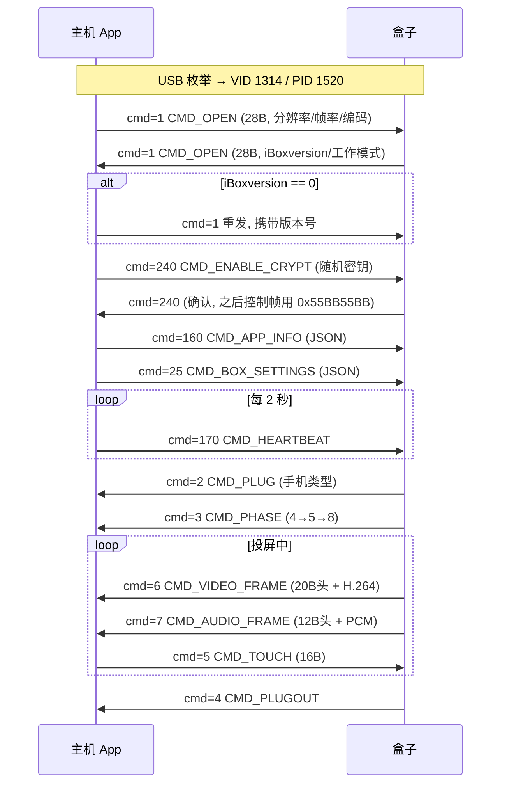
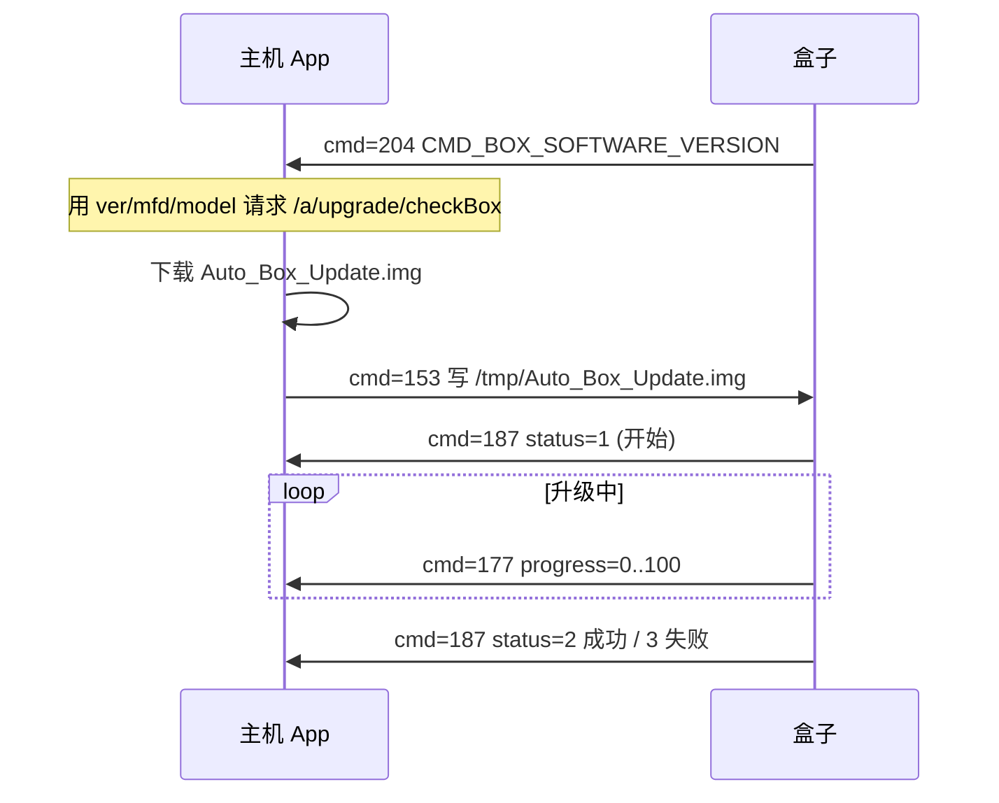
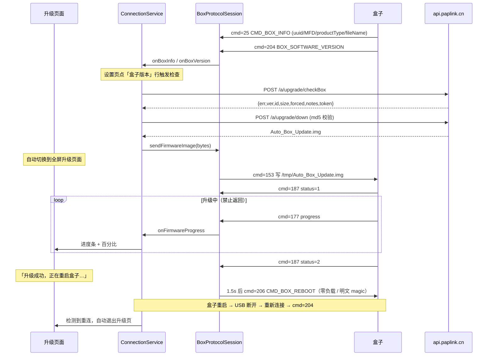

# 盒子 USB 协议（从原版 APK 反编译还原）

来源：`sources/O0_0Ooo/`（混淆后的 `BoxProtocol` / `BoxInterface` / `UsbManager` 三件套）。
`playAuto` 里的 `BoxProtocolSession` 是这个协议的精简重实现。

---

## 1. 传输层

| 项 | 值 |
|---|---|
| 总线 | USB（Bulk 传输，非 HID） |
| VID | `0x1314` |
| PID | `0x1520` / `0x1521` |
| 单次 bulk 上限 | 16384 字节（`f330_o_` 缓冲区） |
| 超时 | 写 4000 ms |
| 读/写 | out 端点写命令，in 端点读帧 |

USB 层不做任何加解密，字节流原样收发。

---

## 2. 帧格式

固定 16 字节头 + 变长负载，**全部小端（LITTLE_ENDIAN）**。

| 偏移 | 长度 | 字段 | 说明 |
|---|---|---|---|
| 0 | 4 | `magic` | `0x55AA55AA` 普通帧；`0x55BB55BB` 加密模式控制帧 |
| 4 | 4 | `length` | **负载长度**，不含 16 字节头 |
| 8 | 4 | `cmd` | 命令号 |
| 12 | 4 | `check` | `~cmd`（**命令号按位取反**，不是长度） |
| 16 | N | `payload` | 命令负载 |

校验规则（`o__o0__0Ooo_.__O_oOOoo()` 写、`OO___()` 读）：

```c
(magic == 0x55AA55AA || magic == 0x55BB55BB)
&& check == (~cmd)
```

### magic 切换逻辑

- 初始全部帧用 `0x55AA55AA`
- 盒子下发 `240 CMD_ENABLE_CRYPT` 后，主机置 `bCrypt = true`
- 此后**除** `cmd ∈ {1, 2, 3, 6, 7, 44}` 和「手机已连接时的 cmd 5」外，
  下行控制帧改用 `0x55BB55BB`；媒体帧（视频/音频/Open/Phase）保持 `0x55AA55AA`
- **负载长度为 0 的帧永远不加密、也不切 magic**（`oO0O00o._oOoOOO()` 在
  `length == 0` 时直接 `return`）。心跳 `170`、重启 `206` 都属于这一类

> `0x55BB55BB` 不只是标记位：非白名单命令在写帧前会调用
> `BoxCore.stCheck(true, payload, nonce, payload)` 就地加密，读帧时再用
> `stCheck(false, ...)` 解密。所以主机与盒子必须共享同一个 32 位 nonce。

---

## 3. 主机 → 盒子 命令表

| cmd | 名称 | 负载 | 说明 |
|---|---|---|---|
| 1 | `CMD_OPEN` (StOpen) | 28 B | 回 `g_Open`，见 §5 |
| 5 | `CMD_TOUCH` | 16 B | 触摸事件，见 §6 |
| 8 | `CMD_CARPLAY_CMD` | 4 B int | CarPlay 子命令，见 §7 |
| 9 | `CMD_CARPLAY_LOGO_TYPE` | 4 B int | 车标类型 |
| 10 | `CMD_BLUETOOTH_ADDR` | 17 B | **车机侧**蓝牙 MAC（ASCII）；原版靠私有广播 `AUTO_BOX_CONTROL_CMD_EVT`(data=100) 透传，长按车机无此广播，故 playAuto 不实现 |
| 13 | `CMD_BOX_BLUETOOTH_NAME` | ≤15 B | 盒子蓝牙名 |
| 14 | `CMD_BOX_WIFI_NAME` | ≤15 B | 盒子 WiFi 名 |
| 15 | `CMD_MANUAL_DISCONNECT` | 0 | 主机主动断开手机；零负载 → 明文 magic，见 §3.1 |
| 17 | `CMD_AUTO_CONN_BT_ADDR` | 17 B | 指定自动回连目标 MAC；与 `8/1002` 互补，1002 由盒子自选 |
| 18 | `CMD_BLUETOOTH_PAIRED_LIST` | N | 已配对列表，换行分隔 |
| 20 | `CMD_CAR_MANUFACTURER_INFO` | 8 B | 2 × int32 |
| 22 | `CMD_CAMERA_INFO` | 4 + N | 首 int 固定 `1`，后接数据（**车机无摄像头，不实现**） |
| 23 | `CMD_MULTI_TOUCH` | N | 多点触摸原始包 |
| 25 | `CMD_BOX_SETTINGS` | JSON | DockPosition / ViewAreaInfo / naviScreenInfo 等 |
| 119 | `CMD_APP_RESET` | 4 B int | 通知盒子 App 已重置 |
| 136 | `CMD_DEBUG_TEST` | 4 B int | 调试用 |
| 153 | `CMD_FILE` | 见 §8 | 写文件到盒子（含 `/tmp/*`、`/etc/*`） |
| 160 | `CMD_APP_INFO` | JSON | App/设备信息 + 进程 PID |
| 162 | `CMD_CONFIG` | JSON | 盒子配置项（单键值） |
| 170 | `CMD_HEARTBEAT` | 0 | 心跳，固定 2000 ms 一次 |
| 206 | `CMD_BOX_REBOOT` | 0 | 重启盒子；零负载、明文 magic `0x55AA55AA` |
| 240 | `CMD_ENABLE_CRYPT` | 4 B int | 下发随机 32 位密钥，握手加密模式 |

### `CMD_TOUCH` (5) 负载 16 B

| 偏移 | 内容 |
|---|---|
| 0 | 事件类型 \| (手指序号 << 8)。单指：`11`/`12`/`13`；双指：`14`/`15`/`16` |
| 4 | X |
| 8 | Y |
| 12 | `androidWorkMode \| (boffscreen << 16)` |

### `CMD_MANUAL_DISCONNECT` (15)

零负载命令，让盒子断开当前连接的手机。原版 `sendManualDisconnectTemp()` 只在两个
场景下发：盒子设置页打开时收到「手机插入」（把手机踢掉，避免设置在投屏中途被改），
以及两块车机型号在屏幕配置变化后强制手机重连。playAuto 改为设置页里的手动入口。

与 `206`/`170` 同样是**零负载 → 明文 magic `0x55AA55AA`**，不受加密状态影响。

> playAuto 下发后会压制自动回连 `60 s`：盒子断开手机后会进入等待阶段并回调
> `maybeAutoConnect()`，不压制就会在 2 秒后自己又连回来。用户点名回连（`17`）或
> 盒子重新上报手机工作时会提前解除压制。

### `CMD_CARPLAY_CMD` (8) 子命令

| 值 | 含义 |
|---|---|
| 7 | 请求使用盒子麦克风 |
| 8 | 请求使用手机麦克风 |
| 9 | — |
| 10 | — |
| 11 / 12 / 13 | 单指按下 / 移动 / 抬起（走 cmd 8 通道的旧式触摸） |
| 15 | 手动断开 |
| 16 / 17 | 夜间模式开 / 关 |
| 21 | — |
| 22 / 23 | 音频传输模式开 / 关 |
| 24 / 25 | WiFi 类型 24 / 25 |
| 201 | 媒体播放中 |
| 1002 | 请求自动连接 |
| 1013 | 请求蓝牙在线列表（HiCar/Carlink 配对流程用，不实现） |

### `CMD_FILE` (153) 负载

```
[4] nameLen          // 含结尾 '\0' 的目标路径长度
[N] name             // 如 "/tmp/Auto_Box_Update.img\0"
[4] dataLen
[M] data
```

上限 50 MB（`52428800`）。靠这个命令写入的路径：

| 路径 | 用途 |
|---|---|
| `/tmp/Auto_Box_Update.img` | 固件升级 |
| `/tmp/night_mode` | 昼夜模式 |
| `/tmp/charge_mode` | 充电模式 |
| `/tmp/screen_dpi` | 屏幕 DPI |
| `/tmp/iphone_work_mode` | iPhone 工作模式 |
| `/etc/box_name` | 盒子名称 |
| `/etc/airplay.conf` | AirPlay 配置 |
| `/etc/oem_icon.png` | 车标图标 |
| `debug_update/*.hwfs` | 特殊固件 |

---

## 4. 盒子 → 主机 命令表

| cmd | 名称 | 负载 | 说明 |
|---|---|---|---|
| 1 | `CMD_OPEN` | 28 B | 握手应答，见 §5 |
| 2 | `CMD_PLUG` | 4 或 8 B | 手机插入；见 §9 |
| 3 | `CMD_PHASE` | 4 B int | 连接阶段，见 §10 |
| 4 | `CMD_PLUGOUT` | 4 B | 手机拔出（值为 1 = 手机端主动断开） |
| 6 | `CMD_VIDEO_FRAME` | 20 + N | 视频帧，见 §11 |
| 7 | `CMD_AUDIO_FRAME` | 12 + N | 音频帧，见 §12 |
| 8 | `CMD_CARPLAY_CMD` | 4 B int | 盒子侧上报，见 §13 |
| 11 | `CMD_CARPLAY_MODE_CHANGE` | 28 B | 显示模式变化 |
| 13 | `CMD_BOX_BLUETOOTH_NAME` | ≤16 B | 盒子蓝牙名 |
| 14 | `CMD_BOX_WIFI_NAME` | ≤16 B | 盒子 WiFi 名 |
| 18 | `CMD_BLUETOOTH_PAIR_LIST` | N | 已配对列表 |
| 19 | `CMD_BLUETOOTH_ONLINE_LIST` | N | 在线设备列表 |
| 22 | `CMD_CAMERA_INFO` | 4 + N | `2`=取图像块，`3`=开摄像头，`4`=关（**车机无摄像头，不实现**） |
| 24 | `CMD_HICAR_URL` | N | HiCar 连接 URL（**常安车机无 HiCar，不实现**） |
| 25 | `CMD_BOX_INFO` | N | 盒子信息串（uuid / mfd / model 等） |
| 42 | `CMD_DASHBOARD_DATA` | N | 仪表数据，`1`=文本 `2/3`=封面图 `100/200`=JSON `202/203`=原始 |
| 43 | `CMD_CONNECTION_PIN_CODE` | 4 + N | 手机类型 + 连接 PIN 码（**仅 HiCar/Carlink 使用，不实现**） |
| 44 | `CMD_DASHBOARD_FRAME` | 20 + N | 副屏视频帧（**容器固件不支持副屏，不实现**） |
| 119 | `CMD_APP_RESET` | 4 B | 要求 App 重置 |
| 136 | `CMD_DEBUG_TEST` | 4 B | 调试 |
| 153 | `CMD_FILE` | 见 §8 | 从盒子拉取文件（log / apk） |
| 161 | `CMD_APP_LOG_GET` | 0 | 要求上传 App 日志 |
| 163 | `CMD_CRYPT_BOX_INFO` | N | 加密版盒子信息 |
| 177 | `CMD_UPDATE_PROGRESS` | 4 B int | 固件升级进度 0~100 |
| 187 | `CMD_UPDATE` | 4 B int | 固件升级状态，见 §14 |
| 204 | `CMD_BOX_SOFTWARE_VERSION` | 32 B（用前 18） | 盒子固件版本，见 §15 |
| 240 | `CMD_ENABLE_CRYPT` | 0 | 盒子确认加密模式 |
| 255 | — | — | 忽略 |

---

## 5. `CMD_OPEN` (1) 负载 28 B（双向同结构）

| 偏移 | 字段 |
|---|---|
| 0 | 屏幕宽 |
| 4 | 屏幕高 |
| 8 | 帧率 |
| 12 | 编码类型（`3`=原始，`5`=H.264 带 20 B 帧头） |
| 16 | 码率/分片大小 |
| 20 | 盒子固件版本编号（`iBoxversion`，`0` = `BOX_VERSION_INVAILD`） |
| 24 | iPhone 工作模式 |

异常保护：`宽 > 4000 || 高 > 4000 || 帧率 > 60` 直接丢弃并日志 `data exception!!!`。

`iBoxversion == 0` 时进入版本校验分支，可用 `PASS`/`FAIL` 重发。

---

## 6. 编码 / 工作模式枚举

### Android 工作模式（`f301_O0_00`）

| 值 | 含义 |
|---|---|
| 0 | `AndroidInvalid` |
| 1 | `AndroidAuto` |
| 2 | `CarLife` |
| 3 | `AndroidMirror` |
| 4 | `HiCar` |
| 5 | `ICCOA` |

### iPhone 工作模式（`f302ooOOO000000`）

| 值 | 含义 |
|---|---|
| 0 | `iPhoneInvalid` |
| 1 | `AirPlay` |
| 2 | `CarPlay` |
| 3 | `NonAirPlay` |
| 4 | `iPhoneCharge` |

### 手机类型（`CMD_PLUG` / `CMD_CONNECTION_PIN_CODE` 的首字节）

| 值 | 含义 |
|---|---|
| -2 | 未识别（初始值） |
| -1 | 无手机 |
| 1 | AndroidMirror |
| 2 | Unknown |
| 3 | CarPlay |
| 4 | iPhoneMirror |
| 5 | AndroidAuto |
| 6 | HiCar |
| 7 | Carlink |
| 8 | CarLife+ |

---

## 7. `CMD_VIDEO_FRAME` (6) 负载

| 偏移 | 字段 |
|---|---|
| 0 | 宽 |
| 4 | 高 |
| 8 | 标志位：bit0 = 熄屏编码；bit1..2 = 压缩方式（`0→2`、`1→1`、`2→4`）；bit3+ 保留 |
| 12 | 时间戳 ms（**仅当盒子版本 ≥ `2024.12.13.1130`**，否则为 0） |
| 20 | H.264 数据 |

---

## 8. `CMD_AUDIO_FRAME` (7) 负载

| 偏移 | 字段 |
|---|---|
| 0 | 解码类型 |
| 4 | float 音量（固定 `1.0f`） |
| 8 | 固定 `3` |
| 12 | PCM 数据 |

---

## 9. `CMD_PLUG` (2) 负载

- 4 B：`phoneType`
- 8 B：`phoneType` + `wifiDeviceConnected`（第 5 字节为 1 表示 WiFi 已连）

---

## 10. `CMD_PHASE` (3) 阶段值

| 值 | 事件 | 含义 |
|---|---|---|
| 3 | `EVT_IPHONE_WORKING` | 手机已工作 |
| 4 | `EVT_WAIT_HOTPOT` | 等待热点 |
| 5 | `EVT_WAIT_AIRPLAY` | 等待 AirPlay |
| 6 | `EVT_IPHONE_WORKING` | 同上 |
| 8 | `EVT_REG` + `EVT_IPHONE_WORKING` | CarPlay / NonAirPlay 正常投屏 |
| 10 | 同上 | 同上，并触发 phonePlugIn |
| 11 | `EVT_CARLIFE_DOWNLOAD` | 需下载 CarLife |
| 13 | `EVT_BOX_CONNECT_DEVICE_FAILED` | 连接失败 |
| 1001 | `HW_ERROR` 50 | 蓝牙硬件异常 |
| 1002 | `HW_ERROR` 51 | WiFi 硬件异常 |
| 1003 | `HW_ERROR` 52 | — |
| 1004 | `HW_ERROR` 53 | — |

---

## 11. 盒子侧 `CMD_CARPLAY_CMD` (8) 上报值

| 值 | 含义 | CarPlay |
|---|---|---|
| 1 / 2 | 开始 / 停止录音 | ✅ 已实现 |
| 3 | `CarPlay_RequestHostUI` | ✅ 已实现 |
| 7 | 使用手机麦克风 | ⛔ 不用（麦克风固定车载） |
| 8 | — | ⛔ |
| 9 / 10 | — | ⛔ |
| 15 | 使用盒子麦克风 | ⛔ 不用（麦克风固定车载） |
| 500 / 501 | 断连 / 重连提示 | ⬜ 未实现 |
| 506 / 507 | 导航开始 / 结束 | ✅ 已实现 |
| 1000 | 盒子支持 WiFi | ⬜ 未实现 |
| 1001 | 盒子支持自动连接 | ✅ 已实现 |
| 1003 ~ 1006 | 蓝牙 / WiFi 状态回报 | ⬜ 未实现 |
| 1007 / 1008 | 蓝牙连接 / 断开 | ✅ 已实现 |
| 1009 / 1010 | WiFi 连接 / 断开 | ✅ 已实现 |
| 1011 / 1012 | 支持 WiFi / 需 KO | ⬜ 未实现 |

> `7 / 8 / 15` 是盒子侧的麦克风来源协商。playAuto 固定使用车载麦克风，
> 因此不响应这些上报；下行固定发 `8 / 7`。

---

## 12. `CMD_UPDATE` (187) 状态值

| 值 | 事件 | 含义 |
|---|---|---|
| 1 | `EVT_BOX_UPDATE` (120) | 开始升级 |
| 2 | `EVT_BOX_UPDATE_SUCCESS` (121) | 升级成功 |
| 3 | `EVT_BOX_UPDATE_FAILED` (122) | 升级失败 |
| 5 | `EVT_BOX_OTA_UPDATE` (125) | OTA 开始 |
| 6 | `EVT_BOX_OTA_UPDATE_SUCCESS` (126) | OTA 成功 |
| 7 | `EVT_BOX_OTA_UPDATE_FAILED` (127) | OTA 失败 |

配套 `177 CMD_UPDATE_PROGRESS` 每帧 4 B 进度值 0~100。

---

## 13. `CMD_BOX_SOFTWARE_VERSION` (204)

负载 32 B，实际只用前 18 B（ISO-8859-1）：

| 偏移 | 字段 |
|---|---|
| 0..14 | 版本号 `YYYY.MM.DD.HHMM`（15 字符） |
| 15 | 保留 |
| 16 | 硬件/渠道后缀单个字母（如 `W` = WiFi 版） |
| 17 | 版本校验码（与 `OoO._oOoOOO` 白名单比对） |

`App` 会把 `0..14` 存为 `BoxVersion`，第 17 字节用于型号合法性校验，同时用它拼出 `/a/upgrade/checkBox` 请求里的 `ver` 字段。

---

## 14. 事件总线（协议之上的抽象）

命令解析完不直接碰 UI，而是发事件号给注册的监听者：

| 事件 | 名称 |
|---|---|
| 0 / 1 | `EVT_ANDROID_PLUG_OUT` / `EVT_ANDROID_PLUG_IN` |
| 2 / 3 | `EVT_IPHONE_PLUG_OUT` / `EVT_IPHONE_PLUG_IN` |
| 4 | `EVT_PHONE_PLUG_IN` |
| 5 / 6 | `EVT_WAIT_HOTPOT` / `EVT_WAIT_AIRPLAY` |
| 9 | `EVT_REG` |
| 12 / 13 | `EVT_OTG_PLUG_OUT` / `EVT_OTG_PLUG_IN` |
| 14 / 15 | `EVT_ANDROID_WORKING` / `EVT_IPHONE_WORKING` |
| 16 | `EVT_CARLIFE_DOWNLOAD` |
| 24 | `EVT_BOX_ENTER_U_MODE` |
| 25 | `EVT_MANUAL_DISCONNECT_PHONE` |
| 29 / 30 / 31 | 摄像头画面 / 开摄像头 / 关摄像头（车机无摄像头，不实现） |
| 32 | `EVT_APP_LOG_GET` |
| 33 | `EVT_APP_UPDATE` |
| 34 | `EVT_APP_RESET` |
| 35 | `EVT_BOX_INFO` |
| 116 | `EVT_BOX_READY` |
| 117 / 118 / 119 | 盒子麦克风检测 / 连接 / 断开 |
| 120 / 121 / 122 | `EVT_BOX_UPDATE` / `SUCCESS` / `FAILED` |
| 123 | `EVT_BOX_VERSION_ERROR` |
| 124 | `EVT_BOX_VERSION_SHOW` |
| 125 / 126 / 127 | `EVT_BOX_OTA_UPDATE` / `SUCCESS` / `FAILED` |
| 200 ~ 215 | 自动连接 / 扫描 / 蓝牙 / WiFi / 盒子信息一系列 |
| 230 | `EVT_UPDATE_CONNECTION_PIN_CODE` |

---

## 15. 典型时序



固件升级时序：



---

## 16. `playAuto` 实现覆盖情况

`playAuto` 已经实现的部分（`BoxProtocolSession`）：

| cmd | 状态 |
|---|---|
| 1 `CMD_OPEN` | ✅ 含版本码协商与重发 |
| 2 `CMD_PLUG` | ✅ |
| 3 `CMD_PHASE` | ✅ |
| 4 `CMD_PLUGOUT` | ✅ |
| 6 `CMD_VIDEO_FRAME` | ✅ 含 ≥`2024.12.13.1130` 的时间戳分支 |
| 7 `CMD_AUDIO_FRAME` | ✅ |
| 13 / 14 盒子名称 | ✅ |
| 18 `BLUETOOTH_PAIR_LIST` | ✅ 解析为 (MAC, 名称) 列表，供 cmd 17 选择；长按删除已由 cmd 18 回写支持 |
| 23 `MULTI_TOUCH` | ✅ |
| 25 `CMD_BOX_INFO` | ✅ **本次新增**，解析 uuid / MFD / productType / fileName |
| 42 仪表数据 | ✅ |
| 153 `CMD_FILE` | ✅ 文件写入（含固件下发） |
| 170 心跳 | ✅ |
| **177 `UPDATE_PROGRESS`** | ✅ **本次新增** |
| **187 `CMD_UPDATE`** | ✅ **本次新增** |
| 204 `BOX_SOFTWARE_VERSION` | ✅ |
| 240 `ENABLE_CRYPT` | ✅ 含 native `stCheck` |
| **206 `BOX_REBOOT`** | ✅ **本次新增**：升级成功（187=2/6）后自动下发，另可在设置页手动触发 |
| **17 `AUTO_CONN_BT_ADDR`** | ✅ 设置 → 更多设置 → 盒子配置 →「指定回连手机」；列表来自 cmd 18 |
| **18 写回** | ✅ 设置 → 更多设置 → 盒子配置 →「删除已配对手机」；回写格式同下发（`MAC+名称\n` + `\0`） |
| **15 `MANUAL_DISCONNECT`** | ✅ 设置 → 更多设置 → 盒子配置 →「断开当前连接的手机」；零负载明文帧，下发后压制自动回连 60 s |
| 10 `BLUETOOTH_ADDR` | ⛔ **不实现**：来源是私有广播 `AUTO_BOX_CONTROL_CMD_EVT`，常安车机不发送 |
| 19 / 24 / 43 / 8-1013 | ⛔ **不实现**：HiCar/Carlink 相关，常安车机已确认无此功能 |
| 22 `CAMERA_INFO` | ⛔ **不实现**：车机无摄像头，且不属于 CarPlay 功能 |
| 8 上报的 `7/8/15` | ⛔ **不实现**：麦克风固定车载，不参与来源协商 |
| 44 `DASHBOARD_FRAME` | ⛔ **不实现**：容器固件不支持副屏（`supportFeatures` 不含 `naviScreen`） |

### 未实现清单

盒子 → 主机：

| cmd | 名称 | 备注 |
|---|---|---|
| 11 | `CMD_CARPLAY_MODE_CHANGE` | 28 B，7 个 int（显示模式/边距等） |
| 119 | `CMD_APP_RESET` | 要求 App 重置 |
| 136 | `CMD_DEBUG_TEST` | 仅打日志 |
| 153 | `CMD_FILE`（盒子→主机） | 拉 log / apk；playAuto 只实现主机→盒子写入 |
| 161 | `CMD_APP_LOG_GET` | 要求上传 App 日志 |
| 163 | `CMD_CRYPT_BOX_INFO` | 加密版盒子信息 |

主机 → 盒子：

| cmd | 名称 | 备注 |
|---|---|---|
| 5 | `CMD_TOUCH`（旧式单指） | 原版由 `BoxInterface._o0o_OoO_0O_Oo_()` 供另一条触控路径使用；playAuto 一律走 23 `MULTI_TOUCH` |
| 160 | `APP_INFO` | version/code/uuid/size/model/platform/android/huid/language/brand/year/so 大段 JSON |

明确不做（车机不支持）：

| cmd | 名称 | 原因 |
|---|---|---|
| 10 | `BLUETOOTH_ADDR` | 常安车机不发送 `AUTO_BOX_CONTROL_CMD_EVT` 广播 |
| 19 / 8-1013 | 蓝牙在线列表（收发两侧） | HiCar/Carlink 配对流程专用 |
| 24 | `HICAR_URL` | **已确认无 HiCar**（原版仅 phoneType==6 使用） |
| 43 | `CONNECTION_PIN_CODE` | **已确认无 HiCar**（原版仅 phoneType 6/7 = HiCar/Carlink） |
| 22 | `CAMERA_INFO`（收发两侧） | **车机无摄像头**，不属于 CarPlay 功能 |
| 8 上报 `7/8/15` | 麦克风来源协商 | **麦克风固定车载**，不属于 CarPlay 功能 |
| 44 | `DASHBOARD_FRAME`（副屏） | **已实测盒子固件不提供副屏能力**，`supportFeatures` 无 `naviScreen` |

半实现项：

- `42 CMD_DASHBOARD_DATA` 只处理 subtype `200`（导航 JSON）；缺 `1` 文本、`2/3` 封面图、`100` JSON、`202/203` 原始
- `8 CMD_CARPLAY` 上报缺 `500/501`（断连/重连提示）、`1000`（支持 WiFi）、`1003~1006`、`1011/1012`（需 KO）；`7/8/15` 麦克风协商按上表不做
- `6 CMD_VIDEO_FRAME` 的 `flags` 解析出来但未使用：`bit2-3` 压缩方式因固定 H.264 无需切换；`bit0` 熄屏编码未处理（原版广播 10/11）
- `25 CMD_BOX_SETTINGS` 只发 4 个单键 JSON；缺 `naviScreenInfo`（副屏画布，随 cmd 44 一并放弃）、`ViewAreaInfo`（多窗口）、`cornerMasks`、`MapThemeMode`、`GNSSCapability`、`fps/dpi/尺寸`
- `4 CMD_PLUGOUT` 未区分值 `1`（手机端主动断开）
- `1 CMD_OPEN` 收到空负载时不会按原版重发 `g_Open`
- 未知命令被静默丢弃，无日志

### 固件升级链路（已打通）



重启策略说明：

- 只有 `187` 状态 `2`（升级成功）与 `6`（OTA 成功）会触发，`1/5` 开始和 `3/7` 失败都不发
- 延时 1.5 s，避免重启指令抢在成功回报之前把 USB 掐断
- 部分盒子固件升级完会自行重启，此时写帧会失败；按正常情况处理，只记状态文案，不弹错误
- `206` 用明文 magic 是刻意的：即使 `libnx1` 未加载或加密状态失步也能送达
  （原版也是只在读帧出错时用它做恢复）

### 固件升级页面（`MainActivity`）

全屏独立页面，四态：

| 阶段 | 触发 | 显示 | 可否退出 |
|---|---|---|---|
| `FIRMWARE_UPGRADING` | 187=1/5 或 177 进度到达 | 进度条 + 百分比 + 「请勿断电」+ 等待重启提示 | ❌ 返回键被拦截 |
| `FIRMWARE_WAIT_REBOOT` | 187=2/6 | 100% + 「升级成功，正在重启盒子…」 | ✅ |
| `FIRMWARE_FAILED` | 187=3/7 或升级中会话中断 | 「升级失败」+ 原因 | ✅ |
| `IDLE` | 退出/自动完成 | 回到进入前的页面 | — |

自动退出条件：进入 `WAIT_REBOOT` 后先检测到会话断开（USB 断开），再检测到重连且 `boxVersion` 重新上报，即判定盒子已重启完成；超过 120 秒未检测到则提示超时并允许退出。

## 17. 升级页面组件复用

`UpgradeProgressPage` 是盒子固件升级与软件更新共用的全屏进度页组件：

```
        标题
   警告提示（WARNING 色）
        45%
   ▓▓▓▓▓▓░░░░░░░░░░░
     状态文字（按阶段变色）
        补充说明
      [退出按钮]
```

提供 `setProgress` / `setStatus` / `setHint` / `setIndeterminate` / `setExitVisible` / `setOnExit`。

### 软件更新流程（`MainActivity`）

| 阶段 | 显示 | 退出 |
|---|---|---|
| `APP_UPDATE_DOWNLOADING` | 「正在下载新版本，请保持网络连接」+ 实时百分比 | ❌ |
| `APP_UPDATE_READY` | 100% + 「下载完成，准备安装」，随即拉起系统安装器 | ✅ |
| `APP_UPDATE_INSTALLING` | 进度条转不确定态，百分比显示「安装中」 | ✅ |
| `APP_UPDATE_FAILED` | 「更新失败」+ 具体原因 | ✅ |

安装成功时进程被替换，页面自然结束；用户取消安装会经 `onActivityResult` 回到本页并提示「已取消安装」。

> 固件升级页与软件更新页共用同一组件，视觉与交互保持一致；两者的返回键拦截、退出文案、状态配色均对应实现。

### 触发入口

- 设置页 **「盒子版本」** 行（点击即可检查更新，不再单独显示「盒子固件更新」选项）
- 盒子自行上报 187/177 时也会自动切到升级页

### 相关类

| 类 | 职责 |
|---|---|
| `BoxFirmwareChecker` | 固件检查（`/a/upgrade/checkBox`）与下载（`/a/upgrade/down`），含 md5 校验与 50MB 上限 |
| `BoxProtocolSession.sendFirmwareImage(byte[])` | 通过 cmd 153 写入盒子 `/tmp/Auto_Box_Update.img` |
| `ConnectionService.firmwareProgress` / `firmwareStatus` | 升级状态缓存，供界面读取 |
| `MainActivity.showFirmwarePage()` / `syncFirmwareState()` | 全屏进度页与状态机 |
| `SettingsScreens` 的「盒子版本」行 | 点击触发固件检查 |
